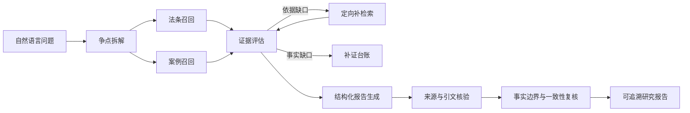

# Legal Deep Research Workbench

面向合同争议、履约纠纷和复杂法律检索任务的证据驱动研究工作台。系统把一次自然语言问题拆成多个争点，分别检索法条和案例，识别证据缺口，执行定向补检索，并对最终报告中的每条主张进行来源、引文和支持关系核验。


## 项目亮点

- **问题拆解**　由语言模型把复杂问题拆成可独立检索的争点，并检查是否覆盖原问题的全部请求。
- **混合检索**　法条和案例分别执行 SQLite FTS5 BM25 与向量召回，再使用 RRF 融合排序。当前向量配置支持阿里云 `text-embedding-v4`。
- **证据缺口驱动**　区分法律依据缺口与案件事实缺口，前者触发定向补检索，后者进入待补证台账。
- **主张级引用核验**　报告不以整段文本作为最小验证单元，而是逐项检查来源是否存在、引文能否逐字定位、证据是否支持具体结论。
- **事实边界控制**　材料记载、用户陈述和待确认事实分开保存。文书存在不同记载时保留差异，不把缺少证据推导成事实不存在。
- **案件材料工作台**　支持 TXT、Markdown、DOCX 和文字型 PDF，保留页码、段落和片段位置，可关联合同、通知和沟通记录。
- **异步任务运行**　支持阶段事件、任务取消、预算控制、浏览器刷新后恢复查看，以及向量服务不可用时的 BM25 降级。

## 端到端流程



## 案件材料链路

案件工作台把用户提交的电子材料作为“材料记载”处理。每个片段保留材料编号、文件名、页码或段落、原文偏移和 SHA-256。模型只能引用本次选入的片段，引用必须逐字匹配。材料抽取和法律依据验证使用不同的数据结构，避免把合同内容误当成法律规范。

工作台还会处理几个容易造成法律误判的边界。

- “通知已寄出”不能自动抽成“通知已到达”。
- 两份文书出现不同交付日期时，两项记载都会保留，并进入待核差异。
- 缺少替代交易凭证不能推导出“没有替代交易”。
- 直接起诉或仲裁的解除时点必须保留确认和副本送达等成立条件。

## 检索与评测

知识库构建脚本支持从已存档的官方资料重建本地索引。研究阶段只访问本地库，建库阶段才会按显式命令刷新固定来源。

扩库前固定语料的离线评测结果如下。该结果是已标注相关来源上的描述性召回指标，用于比较检索方案，不能直接等同于法律回答正确率。

| 资料类型 | K | BM25 Recall@K | 向量 Recall@K | RRF Recall@K |
| --- | ---: | ---: | ---: | ---: |
| 法条 | 4 | 85.3% | 94.7% | 93.0% |
| 案例 | 2 | 100.0% | 98.9% | 100.0% |

评测集包含法条题、案例题和边界控制题，覆盖口语化提问、相近条款、效力差异、无答案查询和停止参照控制。评测定义、标注边界和历史基线见 [`evaluation/README.md`](evaluation/README.md)。

## 项目结构

```text
server.py              本地 HTTP 服务与案件材料 API
research_engine.py     拆题、召回、补检索、生成和引用验证
case_research.py       案件材料、方案比较和全文一致性复核
matter_store.py        案件与本地材料存储
matter_evidence.py     材料抽取、精确定位和差异检测
report_review.py       事实边界与法律条件检查
corpus.py              法条、案例库与 BM25 检索
vectors.py             向量索引与混合召回
evaluation/            评测集、评测脚本和基线报告
test_*.py              单元与集成测试
```

## 快速开始

环境要求为 Python 3.10+、SQLite FTS5 和 Node.js。安装依赖后，准备本地模型配置。

```powershell
python -m pip install -r requirements.txt
Copy-Item .env.example .env
python -X utf8 corpus.py
python -X utf8 vectors.py
python -X utf8 server.py --port 8765
```

打开 <http://127.0.0.1:8765>。默认配置读取 Zhiyu 项目中的模型环境变量，向量模型使用 `model-settings.json` 中的阿里云配置。也可以通过 `.env` 显式设置 `LEGAL_API_BASE`、`LEGAL_API_KEY`、`LEGAL_MODEL` 和 `LEGAL_PROTOCOL`。

## 运行测试

```powershell
python -X utf8 -m unittest discover -s . -p 'test_*.py' -v
```

工作台 v4 的功能验证覆盖材料隔离、DOCX/PDF 解析、来源定位、冲突记载、跨案引用、事实越界、引用核验、HTTP 入口和浏览器导出。

## 数据与隐私

本仓库不包含本地 SQLite 法库、原始法规文件、向量缓存、用户上传材料、运行报告和模型密钥。`.gitignore` 已排除这些内容，`.env.example` 只提供配置字段示例。使用真实材料前，请根据实际部署环境补充访问控制、加密、原件鉴真、审计和多用户隔离能力。

## 研究边界

系统提供可追溯的研究初稿和证据整理能力，不替代律师对现行效力、证据真实性、举证责任、诉讼策略和法律行为的最终判断。当前版本不执行联网实时研究、真实送达、立案、起诉或保全操作。完整流程、预算和边界见 [`RESEARCH-FLOW.md`](RESEARCH-FLOW.md)。

## License

当前仓库用于个人项目展示和技术交流，暂未授予第三方商业使用许可。
